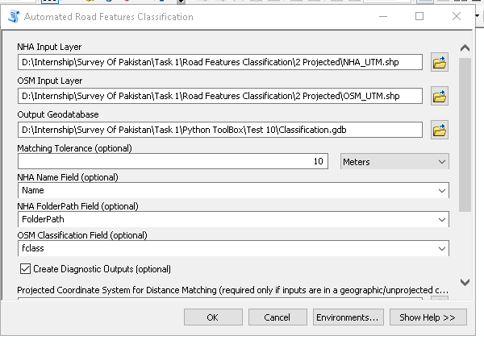
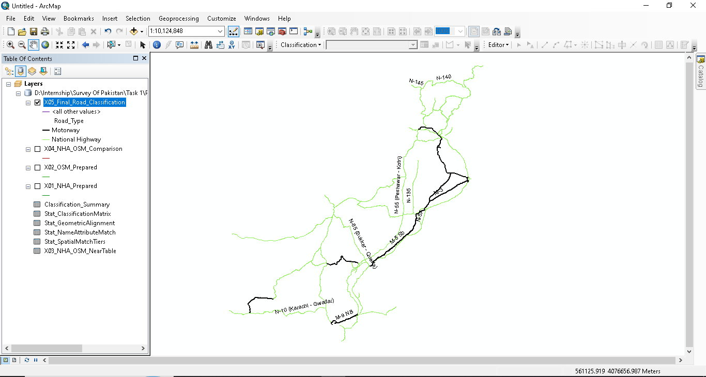
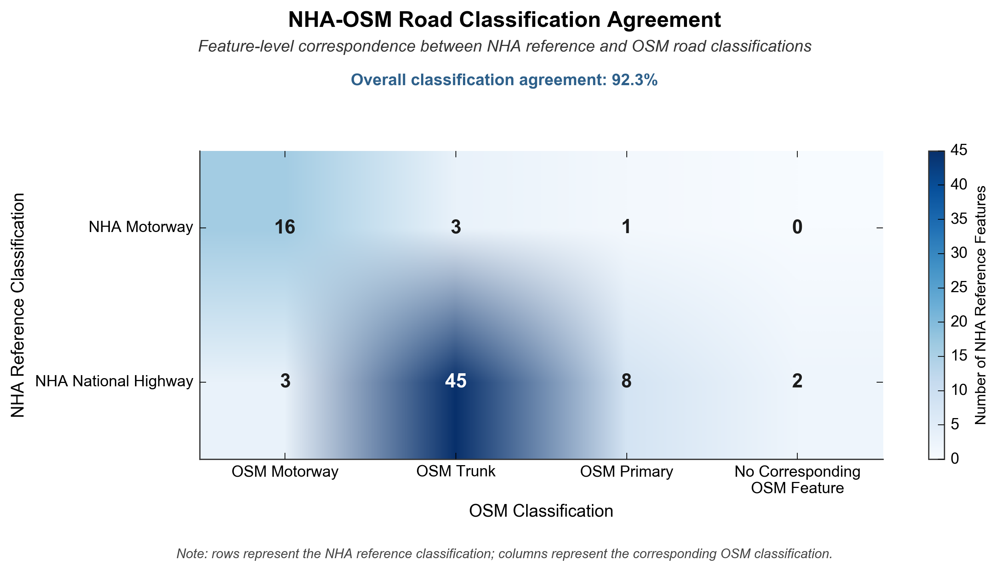

# Road Features Classification Toolbox


An ArcGIS Python Toolbox that automatically classifies National Highway Authority (NHA) road features, cross-validates them against OpenStreetMap (OSM), and produces a statistical data-quality report.

Built during an internship in the **Cartography and GIS Section, Survey of Pakistan**, by **Faseeh Tahir** (BS Geography, University of Gujrat).

---

## What the tool does

A single geoprocessing tool, `Automated Road Features Classification`, runs the whole workflow in one click inside ArcMap 10.8:

1. **Safe copy of inputs.** The NHA and OSM layers are copied into the output geodatabase. Originals are never modified.
2. **NHA classification.** Route-code prefixes in the `Name` field (M-, N-, S-) give Motorway, National Highway or Strategic. Unmatched names are labelled Review, never guessed.
3. **OSM classification.** The OSM `fclass` field is mapped to a normalised road class. Only motorway, trunk and primary (and link variants) are carried forward, and only OSM features within 3 times the matching tolerance plus 50 m of an NHA feature (80 m for the default 10 m tolerance) are kept, which keeps the matching step fast on a national OSM file.
4. **Spatial matching.** Generate Near Table with a configurable tolerance keeps every OSM candidate in range, preserving one-to-many matches.
5. **Classification comparison.** Each NHA/OSM pair is flagged Matched, Matched (Name Confirmed), Conflict, SevereMismatch, Multiple or Unmatched.
6. **Final classification.** `Final_Class` always equals the NHA class. OSM is supporting evidence only and never overrides NHA.
7. **Summary and report.** A classification summary table and a statistical report (a scope statement plus 13 numbered sections, with five charts) are generated.

**Design principle:** NHA is authoritative, OSM only verifies, and every value in the output can be traced back to the rule or match that produced it.



## Repository structure

```
road-features-classification-toolbox/
├── README.md
├── LICENSE
├── .gitignore
├── .gitattributes
├── requirements.txt
├── toolbox/
│   ├── README.md
│   ├── Road_Features_Classification.pyt        (tool source code)
│   └── Road_Features_Classification.pyt.xml    (ArcGIS metadata)
├── reports/
│   └── Final_Statistical_Summary_NHA_vs_OSM.txt
├── internship/
│   └── SoP_Internship_Report_Faseeh_Tahir.docx
└── docs/
    ├── ENVIRONMENT.md
    ├── METHODOLOGY.md
    └── images/                                 (figures from the internship report)
```

## How to use

1. Open ArcMap 10.8 and add `toolbox/Road_Features_Classification.pyt` in ArcToolbox (right-click ArcToolbox, Add Toolbox).
2. Open **Automated Road Features Classification**.
3. Select the NHA roads layer, the OSM roads layer, and an output file geodatabase.
4. Adjust parameters if needed (see below), then click **OK**.

| Parameter | Purpose | Default |
|---|---|---|
| Output Geodatabase | Where all working and final outputs are written | User-specified |
| Matching Tolerance | Search radius for NHA to OSM matching | 10 Meters |
| NHA Name Field | Field with route codes | Name (auto-detected) |
| NHA FolderPath Field | Used only for the informational CPEC flag | FolderPath (auto-detected) |
| OSM Classification Field | Field mapped to road class | fclass (auto-detected) |
| Create Diagnostic Outputs | Keep intermediate tables | True |
| Projected Coordinate System | Needed only if inputs are unprojected | None |
| Generate Statistical Summary Report | Produce the statistical report with charts | True |
| Report Output Folder | Where the report is saved | Required if report is on |
| Positional Accuracy Tolerance | Tolerance for the positional accuracy section | 10 Meters |

Pakistan spans UTM zones 41N, 42N and 43N, so the tool does not guess a projection. If your inputs are geographic, supply a projected coordinate system.

## Outputs

| Dataset | Description |
|---|---|
| `X01_NHA_Prepared` | NHA working copy with `NHA_Class`, `NHA_Category`, `CPEC_Flag` |
| `X02_OSM_Prepared` | Relevant OSM roads with `Road_Class` |
| `X03_NHA_OSM_NearTable` | Raw Generate Near Table output (diagnostic) |
| `X04_NHA_OSM_Comparison` | One row per NHA feature and matched OSM feature, with `Match_Status` |
| `X05_Final_Road_Classification` | Final output, one row per NHA feature (Motorway and National Highway scope), with `Final_Class`, `Road_Type`, `Road_Name`, `Match_Status`, `Match_Count`, `OSM_Match_ID`, `OSM_Class` and `QC_Note` |
| `Classification_Summary` | Counts by class and match status |
| `Stat_NameAttributeMatch`, `Stat_SpatialMatchTiers`, `Stat_GeometricAlignment`, `Stat_ClassificationMatrix` | Detail tables behind the report sections |
| Statistical summary report | `Final_Statistical_Summary_NHA_vs_OSM.pdf` (or `.txt` fallback) in the chosen report folder |
| Report charts | Five figures saved as PNG, PDF and SVG in a `charts` subfolder of the report folder, and embedded in the PDF. Needs `matplotlib` |

Traceability chain: `Final_Class` ← `NHA_Class` ← `OSM_Match_ID` / `OSM_Class` ← `Match_Status` ← `Match_Count`.

`Road_Name` starts from the NHA name. If the best-matched OSM feature carries a different route designation, it is appended, for example `N-85 (OSM: M-2)`, so naming differences between the two datasets are visible in the final layer.



## Results from the sample run

Source: [`reports/Final_Statistical_Summary_NHA_vs_OSM.txt`](reports/Final_Statistical_Summary_NHA_vs_OSM.txt). Run on 121 NHA reference features (78 Motorway and National Highway features in comparison scope) against 6,899 pre-filtered OSM features.

| Measure | Result |
|---|---|
| Motorways agreeing with OSM Motorway | 16 of 20 (80.0%) |
| National Highways agreeing with OSM Trunk/Primary/Motorway | 56 of 58 (96.6%) |
| NHA-OSM classification agreement score | 92.3 / 100 |
| Network completeness (NHA features with an OSM counterpart) | 97.4 / 100 |
| Features within 10 m of an OSM feature (all 121) | 98.3% (119 of 121) |
| Mean / median / max distance to nearest OSM feature | 1.4 m / 0.0 m / 67.1 m |
| Spatial match score | 23.1 / 100 |
| Geometric alignment score | 24.4 / 100 |
| High-confidence match score | 5.1 / 100 |
| Experimental composite index | 48.5 / 100 (band: Poor) |

**How to read these numbers.** Classification agreement and completeness are high, and almost all features lie within 10 m of OSM. The low spatial match, alignment and high-confidence scores come from strict thresholds (at least 60% of NHA length within 5 m), not from gross positional error. The composite index is an experimental equal-weight average, not a validated quality rating. All figures measure OSM agreement with NHA, not absolute accuracy of either dataset. Section 13 of the report lists the full limitations.



## Internship completion

The full internship final report is in [`internship/SoP_Internship_Report_Faseeh_Tahir.docx`](internship/SoP_Internship_Report_Faseeh_Tahir.docx).

| | |
|---|---|
| Organisation | Survey of Pakistan, Ministry of Defence, Government of Pakistan |
| Section | Cartography and GIS |
| Institute | University of Gujrat |
| Internship start | 10 August 2026 |
| Report date | 10 September 2026 |
| Project | Automated Road Features Classification Toolbox |

## Language and environment

| Item | Detail |
|---|---|
| Language | Python 2.7 (the interpreter installed with ArcMap 10.8) |
| Toolbox type | ArcGIS Python Toolbox (`.pyt`) |
| Platform | ArcGIS Desktop / ArcMap 10.8, Windows |
| Core library | ArcPy (installed with ArcGIS Desktop, not installable with pip) |
| Geoprocessing tool used | Generate Near Table |
| Optional library | `reportlab`, for the PDF report. Without it the tool writes a plain-text report |
| Data format | File geodatabase feature classes and tables |

Setup steps, the optional `reportlab` install and a version check are in [docs/ENVIRONMENT.md](docs/ENVIRONMENT.md). Python packages are listed in [requirements.txt](requirements.txt).

## Known limitations

- Some explanatory notes inside the generated report contain fixed example figures from the original run (for example in Sections 0, 7 and 9). Read them as illustrations, not as results for new data. The tables and scores in the report are computed from the data.
- The comparison is one-directional (NHA to OSM). OSM roads with no NHA counterpart are not counted.
- The 5, 15 and 50 m alignment tiers and the 10 m positional tolerance are configured defaults, not derived from source accuracy specifications.
- The NHA/OSM class crosswalk (Trunk or Primary accepted for National Highway) is an editable assumption based on OSM tagging practice in Pakistan.
- No manual spot-check of matches was part of the automated run.
- Results are network-wide and not broken down by route or region.

## License

MIT. See [LICENSE](LICENSE). The NHA and OSM input datasets are not included in this repository. OSM data is © OpenStreetMap contributors (ODbL).

## Author

Faseeh Tahir, BS Geography, University of Gujrat. GitHub: [faseeh-tahir-gis](https://github.com/faseeh-tahir-gis)
